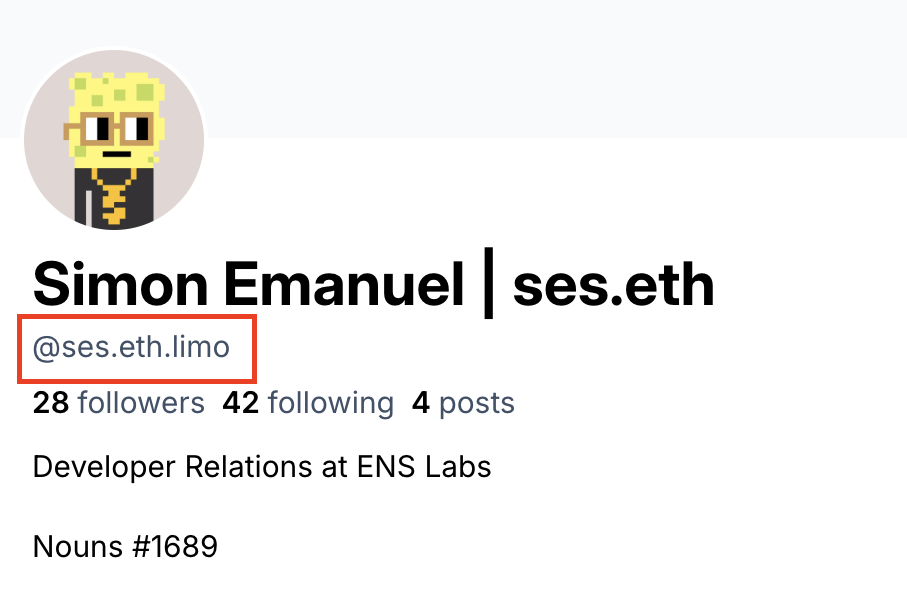
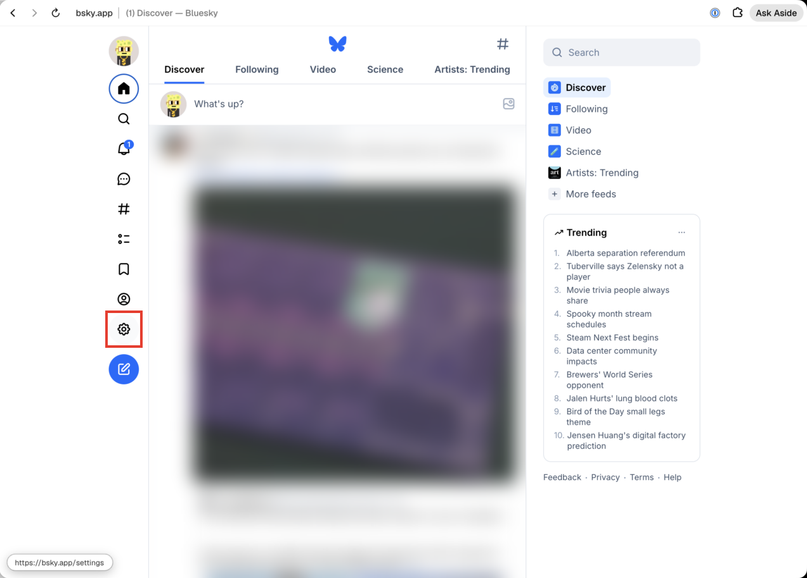
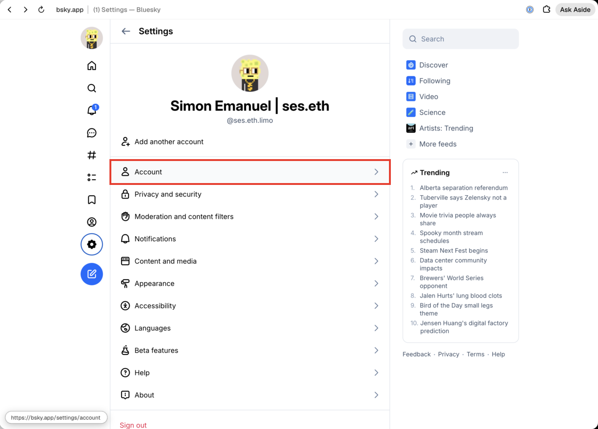
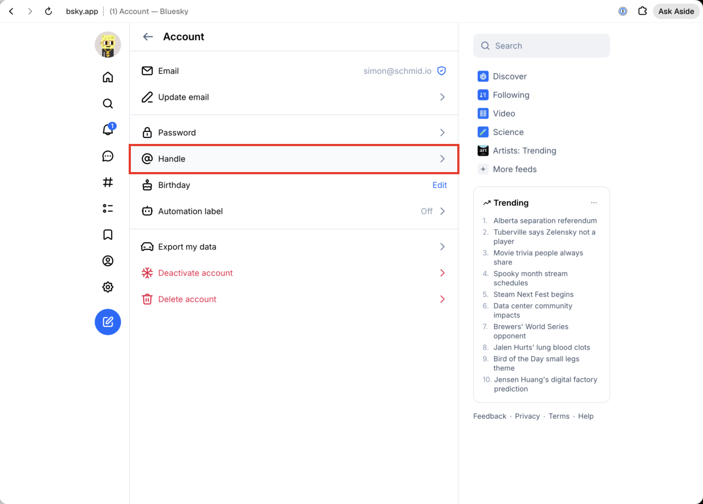
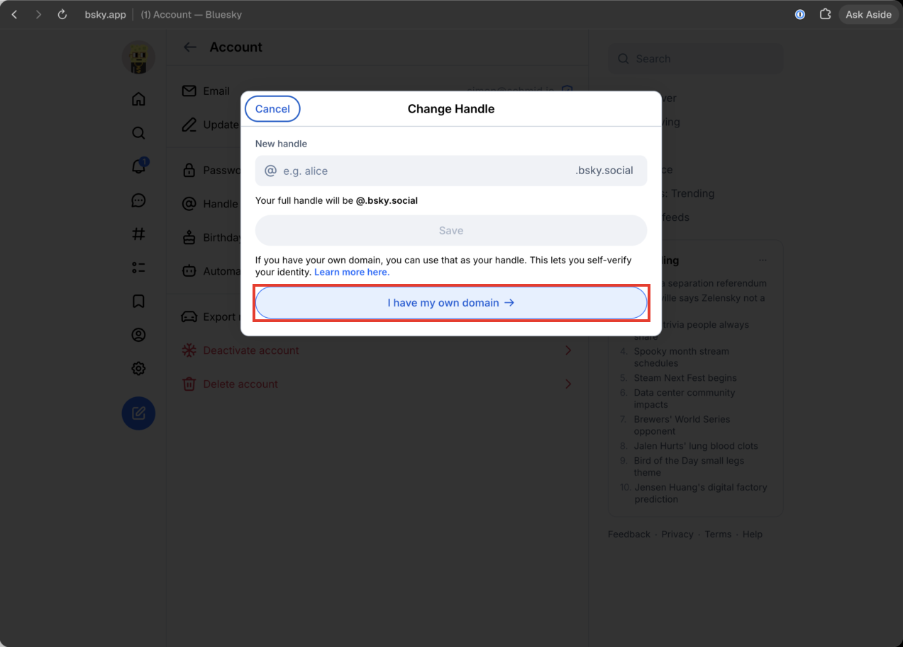
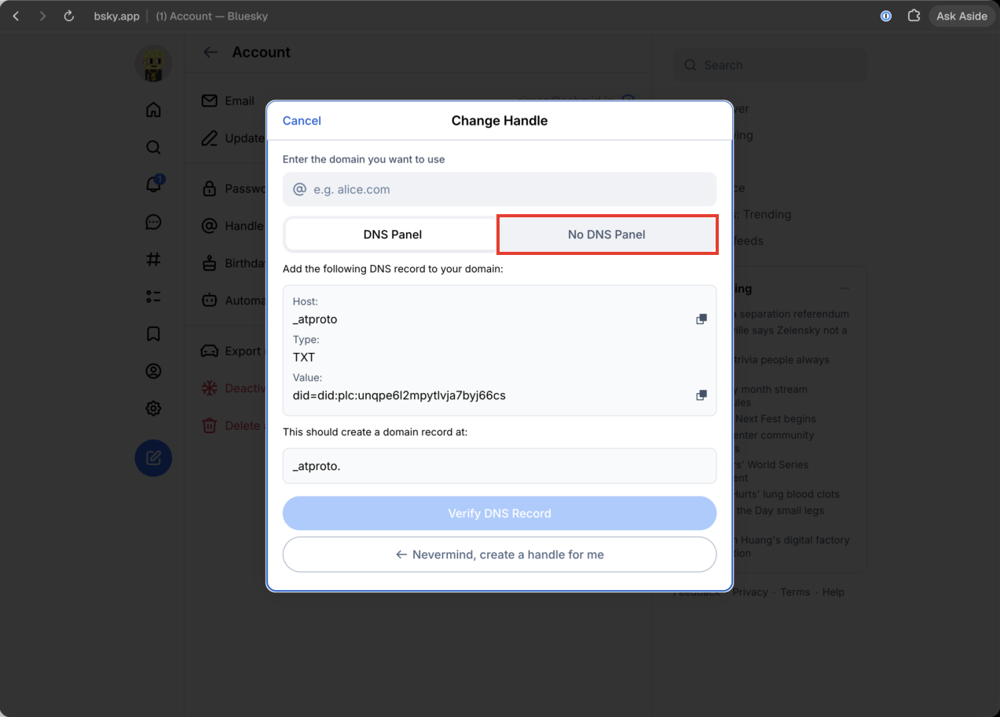
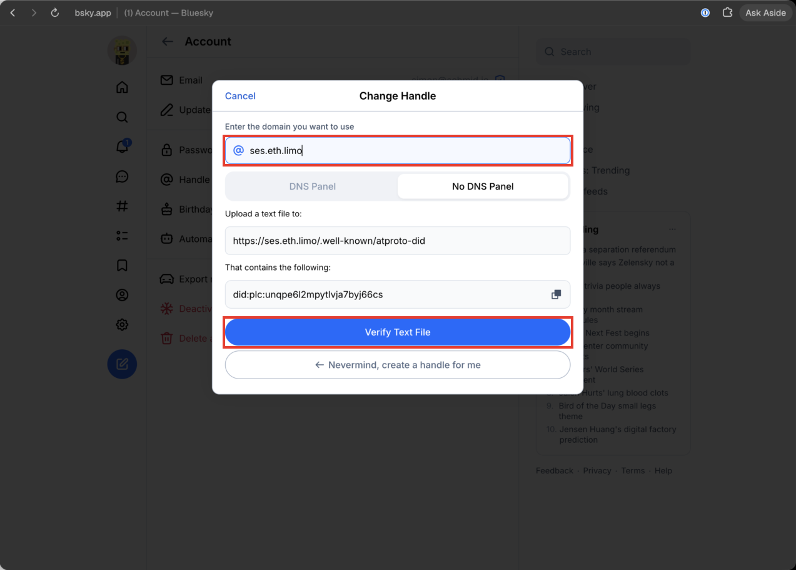

# Bluesky Handle for an ENS + IPFS Website

A Bluesky handle is a domain that proves it belongs to an account's DID. Domains under an
ENS gateway (`name.eth.limo`, `name.eth.link`) cannot get DNS records, so the only option
is the HTTP method: serve the DID at `https://<domain>/.well-known/atproto-did`.

For an IPFS site that means the file must be inside the content that the ENS contenthash
points to. Assume nothing else about the site: any static site generator, any pinning
tool, any wallet.

The goal, the profile showing the ENS domain as its handle:



## 1. Find the DID

Ask the user for their current handle, then resolve it:

```sh
curl -s "https://public.api.bsky.app/xrpc/com.atproto.identity.resolveHandle?handle=<current-handle>"
```

If the current handle is already broken (it shows as `handle.invalid`), the DID is in
Bluesky under Settings > Account > Handle > "I have my own domain" > "No DNS Panel" (see the
walkthrough below). It looks like `did:plc:…`.

## 2. Put the file in the build output

The file is plain text: the DID, nothing else, no trailing whitespace needed.

- Find where the project keeps static files that are copied verbatim into the build
  output (`public/`, `static/`, or the output folder itself).
- Create `.well-known/atproto-did` there with the DID as its only content.
- Build, then confirm the file is in the output folder. Some generators skip dot-paths,
  so check rather than assume.

## 3. Make sure the IPFS upload keeps dot-paths

This is the step that silently fails. Many IPFS tools skip hidden files by default, so
the deploy looks successful but `.well-known` is missing from the CID.

- Kubo: `ipfs add -r` needs `--hidden` (`-H`).
- Other CLIs and pinning UIs: look for a "hidden" or "dot files" option, and read the
  file list they print.
- Tools built on glob libraries (tinyglobby, fast-glob, picomatch) skip dot-paths unless
  `dot: true` is set. If the tool has no flag, patch it (e.g. `pnpm patch`) and add a
  build check so a regression fails loudly.

Verify before updating ENS. Either list the packed files, or fetch the new CID from a
gateway:

```sh
curl -s "https://<CID>.ipfs.dweb.link/.well-known/atproto-did"
```

Some public gateways rate-limit or redirect. Try another one before concluding the file
is missing.

## 4. Point ENS at the new CID

Update the name's contenthash to `ipfs://<CID>` with whatever the user normally uses
(app.ens.domains, a script, a multisig). The owner signs. Never ask for their key.

## 5. Verify the domain

Gateway caches can lag a few minutes after the ENS update.

```sh
curl -sS -w "\n%{http_code}\n" "https://<domain>/.well-known/atproto-did"
curl -s "https://public.api.bsky.app/xrpc/com.atproto.identity.resolveHandle?handle=<domain>"
```

The first must print the DID and `200`. The second must return the same DID. If the
first says `no link named ".well-known"`, go back to step 3.

## 6. Switch the handle (user does this)

In Bluesky: Settings > Account > Handle > "I have my own domain" > "No DNS Panel" > enter the
domain > Verify Text File. The walkthrough below shows each screen. Confirm afterwards:

```sh
curl -s "https://public.api.bsky.app/xrpc/app.bsky.actor.getProfile?actor=<DID>" | grep -o '"handle":"[^"]*"'
```

## Keep it working

Bluesky re-checks handles periodically. Every future deploy must still contain the file,
and every contenthash update must point to a CID that has it. Leave a note in the project
(README or agent instructions) that `.well-known/atproto-did` is load-bearing, so nobody
deletes it as clutter.

## Walkthrough: switching the handle in Bluesky

Screenshots of bsky.app on the web (October 2026), with the next click boxed in red. The
labels are the reliable part, screens change over time. Use them to guide a human, or as
targets when driving a browser. If the UI no longer matches, follow the labels and
tell the user the screenshots are outdated.

1. Open **Settings** (gear icon in the left sidebar).

   

2. Click **Account**.

   

3. Click **Handle**.

   

4. In the Change Handle dialog, click **I have my own domain**.

   

5. Switch to the **No DNS Panel** tab. An ENS gateway domain has no DNS to edit.

   

6. Enter the domain. The dialog now shows the exact URL and DID it will check. They must
   match what "5. Verify the domain" returned. Click **Verify Text File**.

   

On success the dialog closes and the profile shows the new handle, as in the image at the
top.
